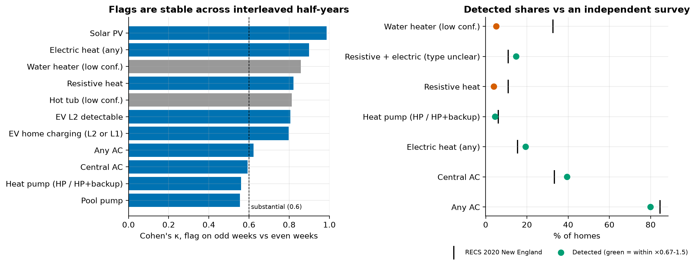

# Validation (task 2.1)

Generated by `scripts/09a_validate.py`. Modeling population 33,927. PLAN.md §5 rule: **every benchmark either sets a threshold or checks one, never both.** Every number on this page is a check; none of them feeds a threshold.

## Validation table

| Area                | Check                                                                                | Value                             | Expectation                                                                                 | Result   |
|:--------------------|:-------------------------------------------------------------------------------------|:----------------------------------|:--------------------------------------------------------------------------------------------|:---------|
| Classification      | EV PU logistic, 5-fold CV AUC                                                        | 0.774 ± 0.027                     | > benchmark 0.736                                                                           | pass     |
| Classification      | HP PU logistic, 5-fold CV AUC                                                        | 0.761 ± 0.046                     | > benchmark 0.738                                                                           | pass     |
| Classification      | EV PU, out-of-customer and out-of-time AUC (odd→even / even→odd)                     | 0.761 / 0.765                     | > benchmark, close to full-year CV                                                          | pass     |
| Classification      | HP PU, out-of-customer and out-of-time AUC (odd→even / even→odd)                     | 0.752 / 0.748                     | > benchmark, close to full-year CV                                                          | pass     |
| Classification      | EV: bagged PU LightGBM vs logistic (CV AUC, recall in top 2%)                        | 0.784 vs 0.774; 34% vs 26%        | adopt LightGBM only if it beats logistic on held-out recall (every cut-off, every CV split) | info     |
| Classification      | HP: bagged PU LightGBM vs logistic (CV AUC, recall in top 2%)                        | 0.773 vs 0.761; 15% vs 17%        | adopt LightGBM only if it beats logistic on held-out recall (every cut-off, every CV split) | info     |
| Classification      | EV Elkan-Noto c estimated from data                                                  | 0.035                             | ≈ 0.25 if SCAR + brief hold                                                                 | fail     |
| Classification      | HP Elkan-Noto c estimated from data                                                  | 0.011                             | ≈ 0.25 if SCAR + brief hold                                                                 | fail     |
| Classification      | EV physics flag count vs implied 186 / 0.25                                          | 2,582 vs 744                      | same order of magnitude                                                                     | fail     |
| Classification      | Labeled EV recall by detector: L2 / L1 / no signature                                | 29% / 7% / 64%                    | reported separately (§5)                                                                    | info     |
| Classification      | Labeled HP: any electric heat / HP-shaped response                                   | 55% / 25%                         | reported (label = ownership, not main heat)                                                 | info     |
| Classification      | PV rule vs complete PV list: precision / recall                                      | 92.0% / 90.2%                     | ≥ 85% / ≥ 85%                                                                               | pass     |
| Stability           | Physics flags, Cohen's κ odd vs even weeks (high/medium-confidence flags)            | min 0.55 (Pool pump), median 0.80 | κ ≥ 0.6 (substantial)                                                                       | pass     |
| Stability           | Low-confidence flags (water heater, hot tub), κ odd vs even                          | 0.86, 0.81                        | stable ≠ correct: still low confidence (RECS check below)                                   | info     |
| Stability           | Heat type (5 classes), κ odd vs even                                                 | 0.78 (agree 92%)                  | κ ≥ 0.6                                                                                     | pass     |
| Stability           | EV class (L2 / L1 / none), κ odd vs even                                             | 0.79 (agree 97%)                  | κ ≥ 0.6                                                                                     | pass     |
| Stability           | Business segment, same segment in both halves                                        | 89% (κ 0.82)                      | κ ≥ 0.6                                                                                     | pass     |
| Stability           | Shape archetype, interleaved weeks (ARI / same archetype)                            | 0.69 / 87%                        | ARI ≥ 0.5                                                                                   | pass     |
| Seasonal            | Flags fire in the expected season (extra kWh/day by season)                          | 9/9 pass                          | all pass                                                                                    | pass     |
| Clustering          | K-Means k = 6 silhouette / Davies-Bouldin                                            | 0.133 / 1.86                      | reported: continuum, not blobs                                                              | info     |
| Clustering          | Bootstrap ARI (20 resamples), mean / min                                             | 0.91 / 0.34                       | mean ≥ 0.8                                                                                  | pass     |
| Clustering          | Segments differ on key features (Kruskal-Wallis ε²)                                  | 0.12-0.58, all p < 1e-10          | p < 0.001; ε² reported                                                                      | pass     |
| Correlations        | Segment heating / cooling slopes vs day-shuffle null (p < 0.01)                      | heat 7/10, cool 10/10             | significant where the segment has electric heat / AC                                        | info     |
| Correlations        | Coincident-peak shares carry bootstrap 95% CIs (max CI width, winter)                | 0.015                             | CIs reported; segment ranking robust                                                        | info     |
| Plausibility (RECS) | Any AC vs RECS NE: uses AC equipment                                                 | 80.0% vs 84.5% (×0.95)            | ×0.67-1.5                                                                                   | pass     |
| Plausibility (RECS) | Central AC vs RECS NE: main AC central (incl. central HP)                            | 39.5% vs 27.9% (×1.42)            | ×0.67-1.5                                                                                   | pass     |
| Plausibility (RECS) | Central AC vs RECS NE: main AC central or ductless HP                                | 39.5% vs 33.3% (×1.19)            | ×0.67-1.5                                                                                   | pass     |
| Plausibility (RECS) | Electric heat (any) vs RECS NE: electricity = main heating fuel                      | 19.4% vs 15.5% (×1.25)            | ×0.67-1.5                                                                                   | pass     |
| Plausibility (RECS) | Heat pump (HP / HP+backup) vs RECS NE: HP = main heating equipment                   | 4.6% vs 3.1% (×1.50)              | ×0.67-1.5                                                                                   | fail     |
| Plausibility (RECS) | Heat pump (HP / HP+backup) vs RECS NE: HP main + ductless HP secondary               | 4.6% vs 6.1% (×0.75)              | ×0.67-1.5                                                                                   | pass     |
| Plausibility (RECS) | Resistive heat vs RECS NE: electric furnace or baseboard = main                      | 4.0% vs 10.9% (×0.37)             | ×0.67-1.5                                                                                   | fail     |
| Plausibility (RECS) | Resistive + electric (type unclear) vs RECS NE: electric furnace or baseboard = main | 14.8% vs 10.9% (×1.36)            | ×0.67-1.5                                                                                   | pass     |
| Plausibility (RECS) | Water heater (low conf.) vs RECS NE: electric main water heater                      | 5.2% vs 32.7% (×0.16)             | ×0.67-1.5                                                                                   | fail     |
| BESS                | Power / SOC / export violations across 22 dispatch runs                              | 0                                 | 0                                                                                           | pass     |
| BESS                | Max energy-balance error (kWh)                                                       | 1.8e-05                           | < 0.01                                                                                      | pass     |
| BESS                | Customers whose recharge sets a new own peak                                         | 0                                 | 0                                                                                           | pass     |
| BESS                | Realistic vs perfect-foresight relief (summer / winter)                              | 67% / 58%                         | gap reported                                                                                | info     |

Role of each check: labels, the implied 744 / 352 counts and RECS are **checks only** (never used to set a threshold). Three checks are allowed to fail by design: c-hat for EV and HP, and the EV flag count vs the implied 744. All three fail, and that failure is itself the finding: the brief's SCAR + c = 0.25 assumption does not hold for these labels, so PU outputs are used as rankings, not probabilities. The RECS gaps are explained in section 4.

## Where each threshold comes from (circularity audit)

| Threshold | Set from | Checked against |
|---|---|---|
| EV L2: ≥ 3 kWh above own baseline, block peak 5.5-12 kW, ≤ 5 h, ≥ 0.5/week | charger ratings (6-11.5 kW L2) | labeled EV recall; implied 744; κ odd/even |
| EV L1: 1.0-2.2 kWh overnight plateau on ≥ 25% of mild nights | 120 V 12-16 A rating | labeled EV recall; κ odd/even |
| Electric heat: heat slope ≥ 0.5 kWh/day/°F | home heat loss ÷ HP COP vs fuel-heat fans | labeled HP; RECS; seasonal check |
| HP shape: slope ×1.25 below 20 °F (×2 = backup) | HP COP curve / strip backup | labeled HP; RECS split |
| Resistive: slope ≥ 1.5, linear | COP = 1 heat loss | RECS split |
| Central AC: cool slope ≥ 1.5 kWh/day/°F | 2.5-5 kW central units | RECS; seasonal check |
| PV: summer-winter midday zero contrast ≥ 0.10, night zeros < 0.05 | delivered-only metering (1.0b) | PV list P/R (only check) |
| Pool: timer score ≥ 0.4, run 3-14 h | timer on/off steps | seasonal check |
| Peak contributor: top 15% of CP kW | program-size choice | not label-checked |
| PU flags | none: PU used only to rank and to grade confidence | CV AUC, out-of-time AUC, c-hat |

## 1. Interleaved odd vs even weeks

Features are rebuilt from scratch on odd weeks only and on even weeks only (both halves span every season; the system peak hours are the full year's). The same physics gates are applied to each half. Each half has ~26 weeks of data, so detectors that count events per week are noisier than on the full year: these κ values are a lower bound on full-year stability.

| flag                        |   share_full_year |   share_odd_weeks |   share_even_weeks |   agreement |   kappa_odd_vs_even |   jaccard_odd_vs_even |   full_year_flags_in_both_halves |
|:----------------------------|------------------:|------------------:|-------------------:|------------:|--------------------:|----------------------:|---------------------------------:|
| EV home charging (L2 or L1) |             0.076 |             0.076 |              0.082 |       0.971 |               0.797 |                 0.685 |                            0.830 |
| EV L2 detectable            |             0.056 |             0.056 |              0.061 |       0.979 |               0.806 |                 0.691 |                            0.842 |
| Electric heat (any)         |             0.194 |             0.193 |              0.194 |       0.968 |               0.898 |                 0.848 |                            0.913 |
| Heat pump (HP / HP+backup)  |             0.046 |             0.048 |              0.048 |       0.960 |               0.560 |                 0.409 |                            0.590 |
| Resistive heat              |             0.040 |             0.039 |              0.039 |       0.986 |               0.821 |                 0.706 |                            0.808 |
| Central AC                  |             0.395 |             0.433 |              0.409 |       0.801 |               0.593 |                 0.618 |                            0.786 |
| Any AC                      |             0.800 |             0.810 |              0.770 |       0.874 |               0.622 |                 0.852 |                            0.901 |
| Solar PV                    |             0.011 |             0.012 |              0.011 |       1.000 |               0.986 |                 0.972 |                            0.982 |
| Pool pump                   |             0.007 |             0.009 |              0.008 |       0.993 |               0.555 |                 0.388 |                            0.661 |
| Water heater (low conf.)    |             0.052 |             0.052 |              0.052 |       0.986 |               0.857 |                 0.762 |                            0.868 |
| Hot tub (low conf.)         |             0.032 |             0.031 |              0.032 |       0.989 |               0.813 |                 0.694 |                            0.818 |

Multi-class: heat type κ **0.78** (same class 92%); EV class κ **0.79** (97%); business segment κ **0.82** (89%).

Segment persistence (share of a half's segment members that land in the same segment in the other half):

| segment                          |   customers_odd |   customers_even |   same_in_even |   same_in_odd |   customers_full_year |
|:---------------------------------|----------------:|-----------------:|---------------:|--------------:|----------------------:|
| Very high load / non-residential |              28 |               28 |          1.000 |         1.000 |                    28 |
| Solar PV                         |             387 |              378 |          0.974 |         0.997 |                   384 |
| Electrified: EV + electric heat  |             924 |              989 |          0.774 |         0.723 |                   927 |
| EV home                          |            1545 |             1698 |          0.806 |         0.733 |                  1563 |
| Electric-heat home               |            5446 |             5430 |          0.887 |         0.890 |                  5477 |
| Low use / seasonal               |            1846 |             1945 |          0.970 |         0.920 |                  1885 |
| Winter peak contributor          |             590 |              520 |          0.446 |         0.506 |                   514 |
| Summer peak contributor          |            2747 |             2668 |          0.698 |         0.719 |                  2710 |
| Emerging load                    |             248 |              169 |          0.448 |         0.657 |                   202 |
| Typical                          |           20166 |            20102 |          0.939 |         0.942 |                 20237 |

PU ranking, out of customer **and** out of time (5-fold: fit on one half-year's features of the training customers, score the other half-year's features of held-out customers):

| model   |   auc_odd_to_even |   auc_even_to_odd |   spearman_between_halves |   top5pct_overlap |
|:--------|------------------:|------------------:|--------------------------:|------------------:|
| EV      |             0.761 |             0.765 |                     0.554 |             0.431 |
| HP      |             0.752 |             0.748 |                     0.710 |             0.512 |

## 2. Seasonal sanity

Extra daily kWh of flagged customers over unflagged, by season. Heating flags should add load in winter (≥ 2x summer), cooling and pool flags in summer, EV / water heater / hot tub all year (positive every season, max/min ≤ 2.5), and PV less in summer (exports clipped).

| flag                        | expected       |   extra_kwh_day_winter |   extra_kwh_day_shoulder |   extra_kwh_day_summer | pass   |
|:----------------------------|:---------------|-----------------------:|-------------------------:|-----------------------:|:-------|
| Electric heat (any)         | winter         |                  43.65 |                    18.35 |                   6.07 | True   |
| Heat pump (HP / HP+backup)  | winter         |                  31.94 |                    12.45 |                   5.80 | True   |
| Resistive heat              | winter         |                  79.98 |                    32.05 |                   7.51 | True   |
| Central AC                  | summer         |                   7.77 |                     7.24 |                  15.70 | True   |
| Pool pump                   | summer         |                   6.83 |                     9.45 |                  23.67 | True   |
| EV home charging (L2 or L1) | all year       |                  30.52 |                    21.67 |                  25.83 | True   |
| Water heater (low conf.)    | all year       |                  35.47 |                    23.45 |                  17.58 | True   |
| Hot tub (low conf.)         | all year       |                  27.65 |                    18.39 |                  14.38 | True   |
| Solar PV                    | less in summer |                  14.07 |                     3.86 |                  -3.83 | True   |

## 3. PU model choice: logistic vs bagged LightGBM

Same 5 folds and same features; bagged PU = 10 LightGBM models, each on all labeled positives vs a fresh random 5x draw of unlabeled customers. All metrics are out-of-fold. Recall in top x% = share of held-out labeled customers ranked in the top x% (fixed cut-offs, identical for both models). The adoption rule was fixed in PLAN.md before running: LightGBM only if it beats logistic on held-out recall; here that is required at every cut-off on the main CV split **and** on 4 more splits.

| target   | model              |   auc |   average_precision |   base_rate |   recall_top1% |   recall_top2% |   recall_top5% |   benchmark_auc |
|:---------|:-------------------|------:|--------------------:|------------:|---------------:|---------------:|---------------:|----------------:|
| EV       | PU logistic        | 0.774 |               0.048 |       0.005 |          0.195 |          0.265 |          0.422 |           0.736 |
| EV       | Bagged PU LightGBM | 0.784 |               0.060 |       0.005 |          0.222 |          0.341 |          0.449 |           0.736 |
| HP       | PU logistic        | 0.761 |               0.017 |       0.003 |          0.115 |          0.172 |          0.253 |           0.738 |
| HP       | Bagged PU LightGBM | 0.773 |               0.012 |       0.003 |          0.069 |          0.149 |          0.287 |           0.738 |

LightGBM minus logistic on 4 more CV splits (positive = LightGBM better):

| target   |     seed |   diff_auc |   diff_average_precision |   diff_recall_top1% |   diff_recall_top2% |   diff_recall_top5% |
|:---------|---------:|-----------:|-------------------------:|--------------------:|--------------------:|--------------------:|
| EV       | 20261113 |     -0.010 |                    0.003 |               0.022 |               0.059 |               0.038 |
| EV       | 20261114 |      0.008 |                    0.008 |               0.059 |               0.070 |               0.038 |
| EV       | 20261115 |      0.013 |                    0.009 |               0.027 |               0.054 |               0.049 |
| EV       | 20261116 |      0.001 |                    0.009 |               0.049 |               0.059 |               0.049 |
| HP       | 20261113 |      0.029 |                   -0.003 |               0.000 |              -0.034 |              -0.023 |
| HP       | 20261114 |      0.050 |                   -0.002 |               0.000 |               0.000 |              -0.011 |
| HP       | 20261115 |      0.037 |                   -0.002 |               0.000 |              -0.023 |              -0.057 |
| HP       | 20261116 |      0.006 |                   -0.000 |               0.000 |              -0.011 |               0.023 |

- **EV: adopt bagged LightGBM.**
- **HP: keep PU logistic.**

Reading: for EV, LightGBM finds 2-8 points more of the held-out labeled EVs in every top-x% on every split, while its AUC edge is not consistent. For HP, LightGBM has the higher AUC but ranks fewer held-out labeled HPs near the top, so logistic stays. Caveat: labels fail SCAR (c-hat far below 0.25), so 'better at finding labeled owners' is the best available yardstick, not proof of better recall of all owners. The adopted EV model's SHAP explanation is in docs/classification.md.

## 4. Plausibility against RECS (independent, not tuned)

Source: EIA, 2020 Residential Energy Consumption Survey, tables HC6.7 (space heating), HC7.7 (air conditioning), HC8.7 (water heating), New England column. RECS describes 2020 and the whole New England division; this data is 2025-26 and one utility territory. 'Consistent' = detected share within ×0.67-1.5 of RECS.

| detected                            |   share_detected |   share_recs_ne | recs_definition                      |   ratio | consistent   |
|:------------------------------------|-----------------:|----------------:|:-------------------------------------|--------:|:-------------|
| Any AC                              |            0.800 |           0.845 | uses AC equipment                    |   0.946 | True         |
| Central AC                          |            0.395 |           0.279 | main AC central (incl. central HP)   |   1.417 | True         |
| Central AC                          |            0.395 |           0.333 | main AC central or ductless HP       |   1.185 | True         |
| Electric heat (any)                 |            0.194 |           0.155 | electricity = main heating fuel      |   1.254 | True         |
| Heat pump (HP / HP+backup)          |            0.046 |           0.031 | HP = main heating equipment          |   1.502 | False        |
| Heat pump (HP / HP+backup)          |            0.046 |           0.061 | HP main + ductless HP secondary      |   0.751 | True         |
| Resistive heat                      |            0.040 |           0.109 | electric furnace or baseboard = main |   0.367 | False        |
| Resistive + electric (type unclear) |            0.148 |           0.109 | electric furnace or baseboard = main |   1.361 | True         |
| Water heater (low conf.)            |            0.052 |           0.327 | electric main water heater           |   0.158 | False        |

Reading the gaps:

- **Total electric heat is consistent (×1.25)**; the uncertain part is the HP vs resistive split. Resistive alone is low (×0.37) but resistive + 'type unclear' is ×1.36: homes with a moderate, linear heating slope (0.5-1.5 kWh/day/°F) are not called resistive, and many baseboard homes land there.
- **Heat pumps sit between the two RECS definitions**: ×1.50 vs HP as main heat, ×0.75 once ductless heat pumps used as secondary heat are included. RECS is 2020; New England heat-pump installs have grown fast since, so a higher 2025-26 share is expected.
- **Central AC is high vs central-only (×1.42), close once ductless HPs are added (×1.19)**: the flag is a size threshold (≥ 1.5 kWh/day/°F of cooling), which several window units together can also reach.
- **Water heater fails (×0.16)**: hourly data catches only homes with large, regular morning bumps. The flag is stable across halves (κ above 0.8), so it measures something consistent, but it is not a saturation estimate. It stays tagged low confidence and is not used by any downstream step.

## Figure

_Runtime 219s._
